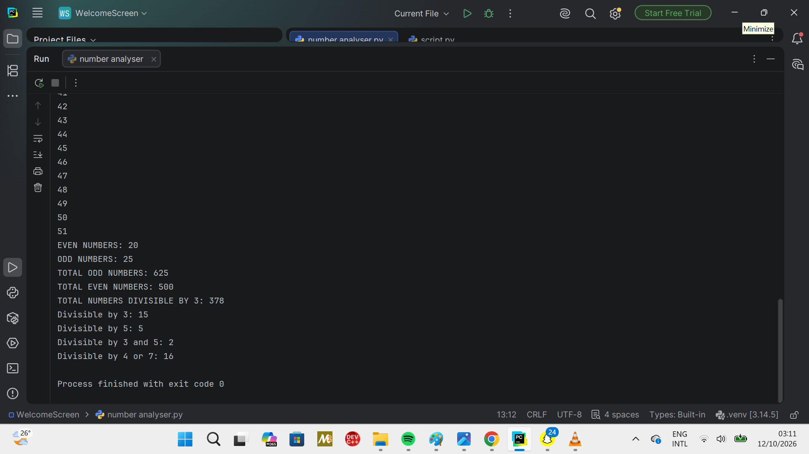

# Number Analyser

A beginner-friendly Python project that analyses numbers from 1 to 50 using loops, conditional statements, and arithmetic operators.

## Project Overview

Number Analyser is a console-based Python program created to practise fundamental programming concepts. It examines numbers in a given range and calculates different numerical properties.

## Features

* Counts even and odd numbers.
* Calculates the sum of even and odd numbers.
* Counts numbers divisible by 3.
* Calculates the sum of numbers divisible by 3.
* Counts numbers divisible by 5.
* Counts numbers divisible by both 3 and 5.
* Counts numbers divisible by 4 or 7.
* Uses `continue` to skip multiples of 10 and `break` to stop processing beyond 50.

## Python Concepts Practised

* `for` loops and `range()`
* `if` statements and conditional logic
* The modulo operator (`%`)
* Logical operators (`and` and `or`)
* Counters and accumulators
* `break` and `continue`
* Formatted strings using f-strings

## How to Run the Project

1. Install Python on your computer.
2. Download or clone this repository.
3. Open a terminal in the project folder.
4. Run this command:

```bash
python "number analyser.py"
```

## Program Output

The screenshot below shows the output produced by the program.



## What I Learned

Building this project helped me practise Python loops, conditions, counters, and totals. It also taught me the importance of testing code, correcting mistakes, and understanding how program logic works.

This project is part of my ongoing programming journey and my goal of becoming an AI/ML Engineer.

